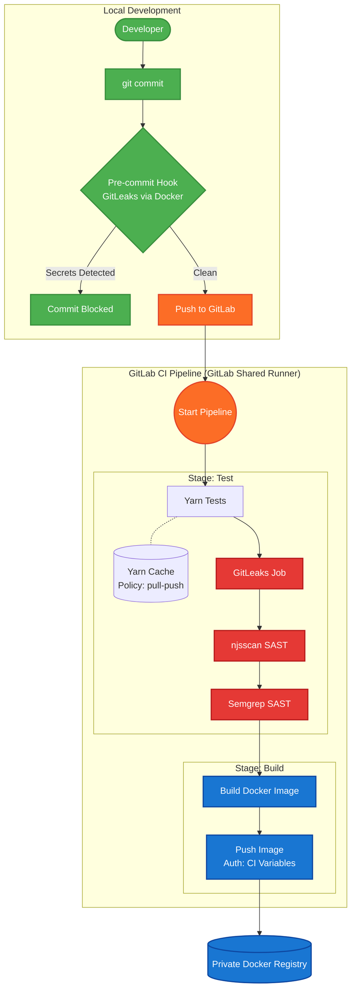
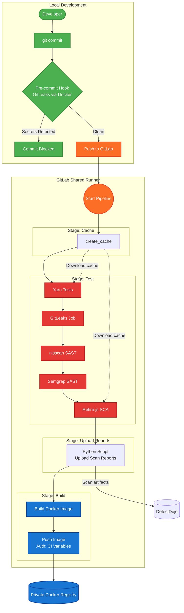
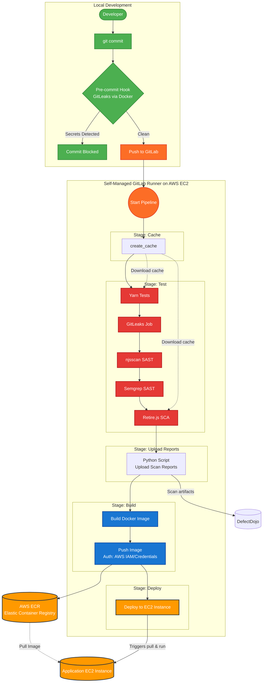

#  OWASP Juice Shop

> [The most trustworthy online shop out there.](https://twitter.com/dschadow/status/706781693504589824)
> ([@dschadow](https://github.com/dschadow)) —
> [The best juice shop on the whole internet!](https://twitter.com/shehackspurple/status/907335357775085568)
> ([@shehackspurple](https://twitter.com/shehackspurple)) —
> [Actually the most bug-free vulnerable application in existence!](https://youtu.be/TXAztSpYpvE?t=26m35s)
> ([@vanderaj](https://twitter.com/vanderaj)) —
> [First you 😂😂then you 😢](https://twitter.com/kramse/status/1073168529405472768)
> ([@kramse](https://twitter.com/kramse)) —
> [But this doesn't have anything to do with juice.](https://twitter.com/coderPatros/status/1199268774626488320)
> ([@coderPatros' wife](https://twitter.com/coderPatros))

OWASP Juice Shop is probably the most modern and sophisticated insecure web application! It can be used in security
trainings, awareness demos, CTFs and as a guinea pig for security tools! Juice Shop encompasses vulnerabilities from the
entire
[OWASP Top Ten](https://owasp.org/www-project-top-ten) along with many other security flaws found in real-world
applications!

For a detailed introduction, full list of features and architecture overview please visit the official project page:
<https://owasp-juice.shop>

## Table of contents

- [Setup](#setup)
    - [From Sources](#from-sources)
    - [Packaged Distributions](#packaged-distributions)
    - [Docker Container](#docker-container)
    - [Vagrant](#vagrant)
    - [Amazon EC2 Instance](#amazon-ec2-instance)
    - [Azure Container Instance](#azure-container-instance)
    - [Google Compute Engine Instance](#google-compute-engine-instance)
    - [Heroku](#heroku)
    - [Gitpod](#gitpod)
- [Demo](#demo)
- [Documentation](#documentation)
    - [Node.js version compatibility](#nodejs-version-compatibility)
    - [Troubleshooting](#troubleshooting)
    - [Official companion guide](#official-companion-guide)
- [Contributing](#contributing)
- [References](#references)
- [Merchandise](#merchandise)
- [Donations](#donations)
- [Contributors](#contributors)
- [Licensing](#licensing)

## Setup

> You can find some less common installation variations in
> [the _Running OWASP Juice Shop_ documentation](https://pwning.owasp-juice.shop/part1/running.html).

### From Sources

1. Install [node.js](#nodejs-version-compatibility)
2. Run `git clone https://github.com/juice-shop/juice-shop.git --depth 1` (or
   clone [your own fork](https://github.com/juice-shop/juice-shop/fork)
   of the repository)

---

For more details see --> [App Juice Shop](https://gitlab.com/dominikjaro_devsecops_bootcamp/notes_overview)

---

# Module 3: Application Vulnerability Scanning

## Setup GiLab CI pipeline, pre-commit script and SAST scanning

[Knowledge base](https://gitlab.com/dominikjaro_devsecops_bootcamp/notes_overview/-/blob/main/chapters_notes/03_application_vulnerability_scanning.md?ref_type=heads)

[repo: app_juice_shop](https://gitlab.com/dominikjaro_devsecops_bootcamp/app-juice-shop)

- We use the OWASP open-source app Juice Shop
- Created a basic GitLab CI pipeline for the app which runs on a GitLab shared runner
  - We run Yarn tests, build the image and push to our private docker registry
  (authentication to registry via GitLab CI variables)
  - To make the pipeline faster we configure caching for Yarn dependencies
    - We set the poicy to pull-push for caching -- so it updates when needed
  - `GitLeak` is the next job in the pipeline which scans for secrets in the repo
    - We set `allow_failure` to true for now so it doesn't block the pipeline
    - Save the output `gitleaks.json` as an artifact (will use it latet yo upload it to Defect Dojo) for review
    - To prevent commiting credentials to the repo we set up a Pre-commit hook
      - In the `.git/hook` dir we create a `pre-commit` file with the script to run `gitleaks` (we are using a docker image and passing the app code)
  - `njsscan`is added and configured in the pipeline to SAST checks
    - We add the flag `--exit-warning` to fail on warnings
  - `semgrep` is added and configured in the pipeline for additional SAST checks
    - Again the output is saved as an artifact for review.

---

# Module 4: Vulnerability Management and Remediation

[Knowledge base](https://gitlab.com/dominikjaro_devsecops_bootcamp/notes_overview/-/blob/main/chapters_notes/04_vulnerability_management_and_remediation.md?ref_type=heads)

[repo: app_juice_shop](https://gitlab.com/dominikjaro_devsecops_bootcamp/app-juice-shop)

## Part 1: GitLab CI scan artifacts and Defect Dojo setup

- In the GitLab CI output scan files and store them as artifacts
- Setup DefectDojo producttype > product ...etc for scan tracking

## Part 2: Automate scan uploads to Defect Dojo

- We created a python script `upload-reports.py` to send scan files to Defect Dojo.
- The script is called in the pipeline after the scans and before the build stage.
- Went through the findings and fixed some security issues.

---

# Module 5: Vulnerability Scanning for Application Dependencies

[Knowledge base](https://gitlab.com/dominikjaro_devsecops_bootcamp/notes_overview/-/blob/main/chapters_notes/05_Vulnerability_scanning_for_application_dependencies.md?ref_type=heads)

[repo: app_juice_shop](https://gitlab.com/dominikjaro_devsecops_bootcamp/app-juice-shop)

**DefectDojo**

## Software Composition Analysis (SCA)

- We added another job and tool into the test stage for dependency scanning.
- Retire.js for JS dependencies.
- Now we built a pipeline for static application testing

---

# Module 6: Build a CD Pipeline

[Knowledge_base](https://gitlab.com/dominikjaro_devsecops_bootcamp/notes_overview/-/blob/main/chapters_notes/06_build_a_cd_pipeline.md?ref_type=heads)

[repo: app_juice_shop](https://gitlab.com/dominikjaro_devsecops_bootcamp/app-juice-shop)

**AWS**

## Setup AWS ECR & EC2 server

- Created repository and configured access
- In the build stage now we are building the image and pushing it to ECR (instead of DockerHub)
- Setup EC2 server for deployment
  - To configure the EC2 server we need to install docker, awscli and add ubuntu user to docker group
    - `sudo apt install docker.io -y`
    - `sudo usermod -aG docker ubuntu`
    - `sudo apt install awscli -y`

## Deploy image to EC2

- Stage: `deploy` -- added another stage which pulls the image from ECR and runs it on EC2
  - Using `ssh` to connect and run commands on EC2

## Self-managed GitLab Runner

- Created an EC2 instance for the runner
  - Need: Docker,awscli and GitLab runner installed
  - In `GitLab` created a project runner and registered it with the EC2 instance (add tags to reference the runner)
  - The self-managed runner saves as time as it has the docker images cached (although be aware of disk space, make sure to clean up)

  
---

# Module 7: Image Scanning - Built Secure Docker Images

[Knowledge base](https://gitlab.com/dominikjaro_devsecops_bootcamp/notes_overview/-/blob/main/chapters_notes/07_image_scanning_build_secure_docker_images.md?ref_type=heads)

[repo: app_juice_shop](https://gitlab.com/dominikjaro_devsecops_bootcamp/app-juice-shop)

**AWS**

## Image Scanning

- Added another job in the build stage: Using `trivy` to scan Docker images
  - We are accessing the image in the ECR and pulling it for scanning with `trivy`
  - Output the findings and upload the artifacts to DefectDojo (set severity level HIGH,CRITICAL)
  - Fixed some vulnerabilities, updated version dependencies/subdependencies
  - Learned Docker Security Best Practices
  - Configured automated image security scanning in AWS ECR (most of the cloud platform support it)

